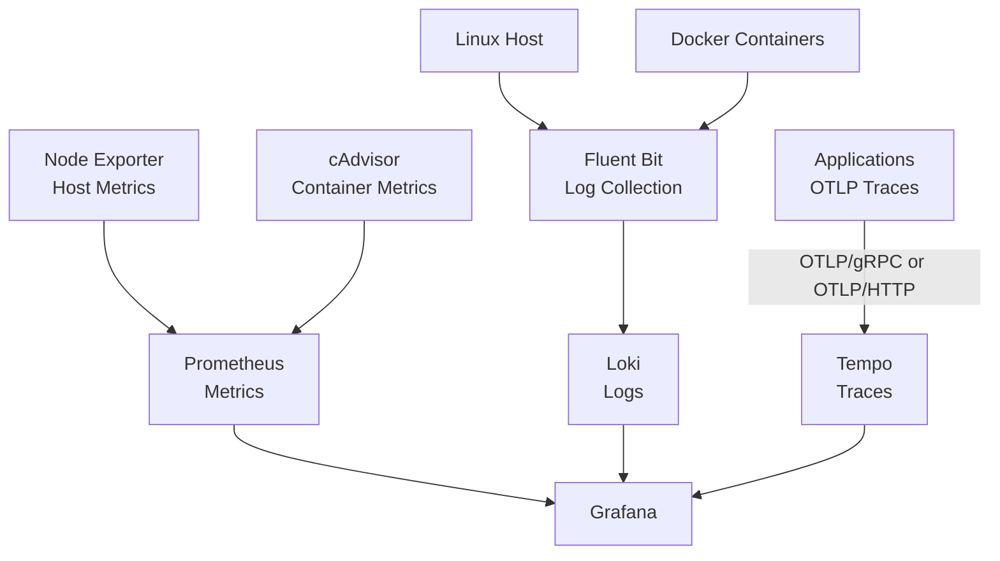

# Homelab Observability Stack

A Docker-based observability stack for monitoring a homelab environment through metrics, logs, and distributed tracing.

This project provides hands-on experience with observability architecture, telemetry collection, persistent storage, retention configuration, and operational troubleshooting using open-source technologies.

The stack is deployed with Docker Compose and is actively used in a personal homelab.

## Architecture



The observability backend runs independently of Kubernetes and is managed through Docker Compose.

## Components

| Component | Purpose |
|---|---|
| Grafana | Metrics, logs, and traces visualization |
| Prometheus | Metrics collection and time-series storage |
| Loki | Centralized log storage and querying |
| Tempo | Distributed trace storage |
| Fluent Bit | Log collection and forwarding |
| cAdvisor | Docker container resource metrics |
| Node Exporter | Host-level Linux metrics |
| Docker Compose | Deployment and service lifecycle management |

## Implemented Features

### 1. Metrics Monitoring

Prometheus collects and stores metrics from the configured monitoring targets.

The current monitoring scope includes:

- Host metrics through Node Exporter
- Docker container metrics through cAdvisor
- CPU and memory utilization
- Container network traffic
- Container filesystem and I/O metrics
- Grafana dashboards for visualizing container resource usage

Prometheus is configured with a 15-day time retention period and a 5 GB storage retention limit.

### 2. Centralized Logging

Fluent Bit collects logs from configured sources and forwards them to Loki.

Current log sources include:

- Docker container logs
- Grafana log files

Logs can be queried through Grafana using Loki as the log data source.

Loki is configured with a 7-day retention period and filesystem-based storage.

### 3. Distributed Tracing

Tempo provides the trace storage backend and is configured to receive OpenTelemetry Protocol (OTLP) data through:

- OTLP/gRPC
- OTLP/HTTP

Grafana is configured to use Tempo as a trace data source.

Trace availability depends on applications or services sending valid trace data. Application instrumentation and end-to-end trace correlation are not assumed to be implemented for every workload.

### 4. Persistent Storage

The stack uses host-mounted directories for persistent service data and configuration.

Persistent storage is configured for the telemetry backends and Grafana state. Runtime data directories are excluded from Git to avoid committing generated data.

### 5. Configuration and Secret Handling

Environment-specific settings are managed through `.env`.

The repository includes `.env.example` as a template, while `.env` and runtime data directories are excluded through `.gitignore`.

Review configuration changes before committing to ensure that credentials, telemetry data, and other sensitive files are not included.

### 6. Docker Compose Operations

The stack supports the standard Docker Compose lifecycle:

```bash
# Validate Compose configuration
docker compose config --quiet

# Start services
docker compose up -d

# Check service status
docker compose ps

# View service logs
docker compose logs --tail=100

# Follow logs for a specific service
docker compose logs -f grafana

# Stop and remove containers and the Compose network
docker compose down
```

Persistent host-mounted data is retained when the stack is stopped with `docker compose down`.

## Default Endpoints

The following endpoints reflect the current host port mappings.

| Service | Endpoint |
|---|---|
| Grafana | `http://localhost:3000` |
| Prometheus | `http://localhost:9092` |
| Loki HTTP API | `http://localhost:3100` |
| Tempo HTTP API | `http://localhost:3200` |
| Tempo OTLP/gRPC | `localhost:4317` |
| Tempo OTLP/HTTP | `localhost:4318` |

These are local access examples. Actual accessibility depends on the Docker port bindings and host network configuration.

## Retention Configuration

| Component | Configured or intended policy |
|---|---|
| Prometheus | 15 days, with a 5 GB size limit |
| Loki | 7 days |
| Tempo | 72-hour target; effective retention requires validation against the running Tempo configuration |

Retention cleanup may occur asynchronously. Configured values should not be interpreted as a guarantee that data is deleted at the exact expiration time.

Fluent Bit buffering is separate from backend retention and is used for log delivery and retry behavior where configured.

## Design Decisions

### Why Docker Compose?

Docker Compose provides a straightforward way to deploy, configure, and troubleshoot the observability services. Keeping the backend outside Kubernetes also avoids making the monitoring platform dependent on the cluster it may need to monitor in the future.

### Why Prometheus?

Prometheus provides time-series metrics collection, PromQL, and integration with Grafana and a broad ecosystem of exporters.

### Why Loki?

Loki provides centralized log storage and querying, complementing the metrics collected by Prometheus.

### Why Tempo?

Tempo provides a backend for storing distributed traces and integrates with Grafana for trace exploration.

### Why Fluent Bit?

Fluent Bit separates log collection and forwarding from log storage and visualization.

### Why Node Exporter and cAdvisor?

Node Exporter provides host-level metrics, while cAdvisor provides container-level resource metrics. Together, they help distinguish host resource constraints from individual container resource consumption.

## Operational Considerations

The project includes practical experience with:

- Persistent telemetry storage
- Retention configuration
- Centralized logging
- Metrics collection and dashboard validation
- Trace backend configuration
- Docker Compose service lifecycle management
- Troubleshooting individual observability components

A running container does not necessarily mean its complete telemetry pipeline is healthy. Collection, ingestion, storage, and querying should be verified independently.

## Planned Future Improvements

The following items are not represented as completed features in the current version.

### Alerting and Reliability

- Prometheus Alertmanager
- Alert routing and notifications
- Grafana alerting
- SLI/SLO dashboards and error-budget tracking

### Kubernetes Monitoring

- k3s cluster monitoring integration
- kube-state-metrics
- kubelet and Kubernetes container metrics
- Kubernetes log collection
- Additional Kubernetes-specific dashboards

### Telemetry and Instrumentation

- OpenTelemetry Collector
- Application instrumentation and end-to-end trace validation
- Correlation between metrics, logs, and traces

### Operational Maturity

- Automated configuration validation
- Backup and recovery procedures
- More comprehensive failure testing
- Long-term remote metrics storage
- High availability and multi-node deployment
- Cloud infrastructure provisioning and Infrastructure as Code

These improvements will be introduced when they address a concrete operational requirement.

## Project Scope

**Version:** V1  
**Status:** Operational homelab project  
**Deployment:** Docker Compose  
**Primary focus:** Metrics, logs, traces, and host/container monitoring

The current version focuses on the core observability stack and its use in a personal homelab. Kubernetes integration, alerting, high availability, and other enhancements remain future work unless explicitly implemented and validated.